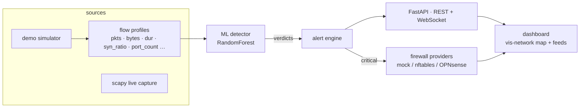

# 🐕 LassiNet

**Network visibility + ML-based intrusion detection + firewall control — in one lightweight dashboard.**

LassiNet maps a network in real time (devices, links, open ports), profiles traffic,
scores every flow with a machine-learning model, raises alerts, and lets you block a
host in the firewall **with one click — or automatically** for critical alerts.
Think of it as a mini NDR + IDS + SOAR that fits in a single Python app.

<!-- LassiNet dashboard demo (uncomment when docs/demo.gif exists):

-->

[](LICENSE)
[](https://github.com/bryanherflo/lassinet/actions/workflows/ci.yml)
[](#)

[](#)
[](#)
[](#)

---

## ✨ Features

| | |
|---|---|
| 🗺️ **Topology map** | Live network graph: devices, roles (router, server, IoT, attacker…), links, blocked status. Traffic animates as role-tinted packet dots with comet trails; attack paths glow red from attacker → router → victim. Deterministic tree layout (Internet → router → devices), zero physics drift. |
| 📡 **Traffic capture** | Flow aggregation from a real sniffer (scapy) or a built-in simulator. Works on any subnet (10.x, 172.16.x, 192.168.x, custom CIDR via `LASSI_DEMO_NET` / `LASSI_SUBNET`). |
| 🧠 **ML IDS** | RandomForest classifying flows into *benign / port_scan / brute_force / ddos / data_exfiltration*. Per-mode models (synthetic for demo, CICIDS2017 for live). Rule-based fallback when model missing. |
| 🚨 **Threat feed** | Severity-ranked alerts with confidence, detection engine (`ml` vs `rules`), timestamps and readable attack names. Each alert has a one-click **Block source** action; high/critical hits also raise a dismissible banner. |
| 🧱 **Firewall control** | `mock` (default), `nftables` (Linux; real enforcement), `opnsense` (alias_util API; real enforcement), and `pfsense` (documented placeholder). Blocks are **source-only**, can target an unknown external IP, and are reversible with Unblock. Auto-block on critical alerts (SOAR-style); blocked sources are dropped from the flow counters and packet animation. Active nftables blocks are restored into the dashboard after a restart. |
| 🤖 **Auto-response** | Optional auto-block of high/critical sources. Configurable via `LASSI_AUTO_BLOCK`. |
| 📜 **System log + audit trail** | Colour-coded event stream in UI **and** local JSONL log (`logs/events.jsonl`, tail via `GET /api/logs?limit=N`). The Firewall panel shows active blocks only; the log keeps the full BLOCK/ALLOW history. |
| ⚡ **Zero config** | `pip install` → `python app.py` → open `http://localhost:8000`. Demo mode needs no privileges. Map library bundled locally — no CDN, no build step, works offline. |
| 🎯 **Intuitive UX** | Click a device for the **action bar** (Block/Unblock, Actions…), right-click for the **trust menu**, double-click to rename, and press `?`/`H` for the built-in Help. Confirmed attackers escalate on the map; `B` blocks, `R` refits, `M` minimizes, `L` toggles the legend, `D` hides the traffic dots, `Esc` closes. Responsive layout, live-stream indicator, reduced-motion support. |

## 🚀 Quickstart

```bash
git clone https://github.com/bryanherflo/lassinet.git
cd lassinet
pip install -r requirements.txt

# run (demo mode, simulated network, safe everywhere)
python app.py
```

> The tiny demo model **auto-trains on first run** when missing (a few seconds) — running `python ml-training/train_model.py` manually is equivalent, not required. The rule-based engine still works even then.

**Run the test suite** (65 unit + API smoke + dashboard-asset tests, no network needed):

```bash
pip install -r requirements-dev.txt
python -m pytest tests/ -q
```

Open **http://localhost:8000** — within seconds you will see devices joining the map, an attacker appear, attack scenarios detected by the ML engine, and auto-blocks fired.

**About the packet dots on the map** (and honesty about what they show): the travelling dots are *not* decoration — they are rendered **only** from the engine's real flow stream. Every dot corresponds to an actual flow (source, destination, byte size, verdict) that passed through the detection pipeline. In **demo mode** that network is simulated (the badge says *"demo (simulated)"*: the simulator generates the flows, but they still go through the same ML detection → alert → firewall path as real packets). In **live mode** (`LASSI_MODE=live`) the same pipeline feeds the dots from **physically sniffed packets**, so the traffic you see is the traffic on your wire.

**What Block does:** every block is **source-only**. `Block source <IP>` on an alert, or `Block IP` on a device, adds a firewall rule for that IP (never the victim), marks the device as blocked, and stops counting or animating traffic **from** it. In demo mode the rule is simulated (`mock` provider) - nothing on your PC changes. In live mode **nftables** (Linux, root, pre-created table/chain) or **OPNsense** (existing alias + rule) enforces the rule; `mock` only logs, and `pfsense` is still a placeholder. If the provider rejects the operation, the API reports an error and the IP is **not** marked as blocked. `Unblock` reverses it. The router and the Internet placeholder are protected and can never be blocked.

**Shortcuts:**
- Click a node → action bar (Block/Unblock, Actions…, close)
- Right-click a node → trust menu (mark trusted / suspicious, clear, or block/unblock)
- Select a node on the map and press `B` to block it
- Double-click a node to rename it (persists across restarts)
- Press `H` or `?` for the Help dialog, `R` to refit the map, `M` to minimize it, `L` to toggle the legend, `D` to hide/show the traffic dots
- Press `Esc` to close Help / the trust menu / the alert banner and clear the selection
- Use the feed and rule buttons to block/unblock; the Firewall panel lists active blocks only

The badge at the top right of the map shows the live stream state: `live` while the WebSocket pushes snapshots, `polling` when it falls back to `/api/state`, and `connecting…` during startup or reconnect.

## 🧪 Modes & configuration

| Env var | Values | Default | Meaning |
|---|---|---|---|
| `LASSI_MODE` | `demo` / `live` | `demo` | simulated network vs real ARP discovery + sniffing |
| `LASSI_FW` | `mock` / `nftables` / `opnsense` / `pfsense` | `mock` | firewall provider; `nftables` and `opnsense` enforce, `pfsense` is still a placeholder |
| `LASSI_AUTO_BLOCK` | `0` / `1` | `1` (demo), `0` (live) | auto-block high/critical sources |
| `LASSI_HOST` | IP | `127.0.0.1` | bind address |
| `LASSI_PORT` | int | `8000` | dashboard port |
| `LASSI_SUBNET` | CIDR | *auto-detect* | network to ARP-sweep in live mode; defaults to the subnet the machine lives on |
| `LASSI_DISCOVERY_INTERVAL` | seconds | `30` | how often live mode refreshes the ARP topology (`0` = every engine tick) |
| `LASSI_DEMO_NET` | CIDR | `10.0.0.0/24` | base subnet for the simulated demo network - change it and every demo device/attack story moves to that addressing |
| `LASSI_IFACE` | interface name | *default* | pin sniffing interface for multi-network laptops |
| `LASSI_LOGFILE` | path | `logs/events.jsonl` | local JSONL event log: every alert, block and startup appended as one line |
| `LASSI_NAMEFILE` | path | `data/device_names.json` | where user-given device names (double-click on a node) are persisted across restarts |

**Live mode** (real traffic, opt-in — needs admin/root, `pip install scapy`, and ideally the real-data model `python ml-training/load_cicids.py`, otherwise the rule-based engine is used):

```bash
pip install scapy
LASSI_MODE=live python app.py
```

Live mode performs an **auto-detected ARP sweep** - it starts on the subnet the machine itself lives in (any RFC1918/DHCP range), marks the real default gateway as the router hub, and aggregates sniffed packets into the *same* flow features the model was trained on. The topology is refreshed every 30 s by default (`LASSI_DISCOVERY_INTERVAL`), not on every engine tick, so it does not flood the LAN with ARP. Detections follow the same pipeline as the demo; manual blocks call the configured provider.

If `scapy` is not installed, LassiNet logs the reason and falls back to demo mode instead of pretending to capture; the badge shows `demo (fallback: scapy missing)`. If the sniffer starts but fails later (usually missing admin/root privileges or a bad `LASSI_IFACE`), the badge changes to `live (capture error)`, `GET /health` returns `ok: false` with `capture_error`, and the engine stops ARP-sweeping. A normal live sensor reports `capture_running: true`.

**Live-mode limits:** it sees only traffic that reaches the capture interface. On a switched LAN, use a SPAN/mirror port or run it on the gateway; it is not a promiscuous whole-network sensor by default. The live model should be validated on your own traffic, and this project is a lab/demo sensor, not a production IPS.

**OPNsense setup (real enforcement):** create an alias named `lassinet_blocked` (Host, Network or External type) and a firewall block rule that uses it as the source, then set `LASSI_FW=opnsense`, `OPNSENSE_URL`, `OPNSENSE_KEY`, `OPNSENSE_SECRET` and optionally `OPNSENSE_ALIAS`. LassiNet only adds/removes addresses in that alias via `/api/firewall/alias_util/`; it does not create the alias or the rule. With a self-signed certificate, set `OPNSENSE_VERIFY_TLS=0` only in a lab. `pfsense` still uses a different REST API and remains a placeholder.

## 🔬 Training on a real dataset

The bundled trainer generates a labelled synthetic-flow dataset (fast, reproducible — used by CI). For realistic research-grade metrics, train on the public [CICIDS2017](https://www.unb.ca/cic/datasets/ids-2017.html) benchmark:

```bash
python ml-training/load_cicids.py               # downloads ~290 MB (cached), trains 4 classes
```

This fetches three day-files (Tuesday: SSH/FTP brute force, Friday: DDoS + PortScan + benign), projects each CICFlowMeter row onto LassiNet's 8 flow features, and saves the model + `models/metrics.json`, which the dashboard shows as a badge.

Metrics (`models/metrics.json`) are displayed as a badge on the dashboard.

## 📚 Cite

If you use results obtained with `load_cicids.py`, cite the dataset authors:

> Sharafaldin, A., Habibi Lashkari, A., Ghorbani, A. — *“Toward Generating a New Intrusion Detection Dataset and Intrusion Traffic Characterization”*, ICISSP 2018.

## 🏗️ Architecture



```
lassinet/
├── app.py                 # FastAPI entrypoint + engine loop
├── lassi/
│   ├── state.py           # thread-safe hosts / edges / alerts / rules
│   ├── simulator.py       # demo mode: devices + attack "stories"
│   ├── live.py            # live mode: ARP discovery + flow sniffer (scapy)
│   ├── ml.py              # feature extraction + inference (+ rule fallback)
│   ├── firewall.py        # mock / nftables / OPNsense providers
├── ml-training/           # dataset generation + training + metrics
│   └── load_cicids.py     # real-data path: CICIDS2017 → 8 LassiNet features
├── models/                # lassi_model.pkl (live) / demo_model.pkl (demo) + metrics (generated)
├── dashboard/             # static UI (bundled vis-network), no build step
└── docs/                  # architecture + lab guide
```

## 🔬 Method notes

* **Flows, not packets** — the model consumes 8 aggregated features per flow (packets, bytes, duration, SYN ratio, distinct destination ports, mean packet size, packet rate, bytes/packet). Aggregate features make detection fast and dataset-portable (same shape as NIDS classics like CICIDS2017).
* **One model per mode** — the demo simulator and real traffic have different statistics, so each mode is served by a model trained on its own distribution (`models/demo_model.pkl` synthetic ↔ `models/lassi_model.pkl` CICIDS2017); the dashboard badge shows the metrics of whichever is active.
* **Defence in depth** — when no model file is present, a deterministic heuristic engine takes over, so the platform is still useful (and the dashboard badge shows which engine fired each alert).
* **Real-data results** (`ml-training/load_cicids.py`, 3-day CICIDS2017 subset, ≈958k labelled flows, 250k stratified subsample, RandomForest):

  | class | precision | recall | F1 |
  |---|---|---|---|
  | benign | 0.99 | 0.99 | 0.99 |
  | port scan | 0.99 | 1.00 | 1.00 |
  | SSH/FTP brute force | 1.00 | 0.77 | 0.87 |
  | DDoS | 0.95 | 0.99 | 0.97 |

  overall accuracy **0.99** · macro-F1 **0.96** · hyper-parameters chosen with `ml-training/compare_configs.py` (weighting trade-off documented in-code).
  Known limitation: per-flow CIC CSVs carry no per-source grouping, so the `dst_port_count` signal is neutral on real data.

## ⚠️ Ethics & scope

LassiNet is an **educational project**: discovery, capture, and blocking must only ever run against **networks you own or are authorised to test** (your lab, your homelab, a CTF, a written pentest engagement). Sniffing other people's traffic without consent is illegal in most jurisdictions. The default mode is a fully simulated network for exactly that reason.

## 🗺️ Roadmap

- [x] Unit + API tests (`pytest`, 39 tests) with GitHub Actions CI
- [ ] Zeek/Argus feed instead of hand-rolled flow aggregation
- [ ] Host-shield agents (report process/service inventory)
- [ ] Alert → playbook chain (block + re-scan + report generation)
- [ ] Optional React frontend (the static dashboard is already functional)

## 👤 Author

**Bryan Hernandez Florian** — built as a cybersecurity master's portfolio project.
GitHub: [github.com/bryanherflo](https://github.com/bryanherflo) · LinkedIn: [linkedin.com/in/bryan-hernandez-florian](https://www.linkedin.com/in/bryan-hernandez-florian)