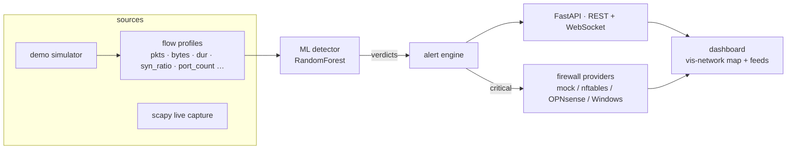

# 🐕 LassiNet

**Network visibility + ML-based intrusion detection + firewall control — in one lightweight dashboard.**

LassiNet maps a network in real time (devices, links, open ports), profiles traffic,
scores every flow with a machine-learning model, raises alerts, and lets you block a
host in the firewall **with one click — or automatically** for critical alerts.
Think of it as a mini NDR + IDS + SOAR that fits in a single Python app.

<!-- LassiNet dashboard demo (uncomment when docs/demo.gif exists):

-->

[](LICENSE)
[](https://github.com/bryanherflo/lassinet/actions/workflows/ci.yml)
[](#)

[](#)
[](#)
[](#)

---

## ✨ Features

| | |
|---|---|
| 🗺️ **Topology map** | Live network graph: devices, roles (router, server, IoT, attacker…), links, blocked status. Traffic animates as role-tinted packet dots with comet trails; attack paths glow red from attacker → router → victim. Deterministic tree layout (Internet → router → devices), zero physics drift. |
| 📡 **Traffic capture** | Flow aggregation from a real sniffer (scapy) or a built-in simulator. Works on any subnet (10.x, 172.16.x, 192.168.x, custom CIDR via `LASSI_DEMO_NET` / `LASSI_SUBNET`). |
| 🧠 **ML IDS** | RandomForest classifying flows into *benign / port_scan / brute_force / ddos / data_exfiltration*. Per-mode models (synthetic for demo, CICIDS2017 for live). Rule-based fallback when model missing. |
| 🚨 **Threat feed** | Severity-ranked alerts with confidence, detection engine (`ml` vs `rules`), timestamps and readable attack names. Each alert has a one-click **Block source** action; high/critical hits also raise a dismissible banner. |
| 🧱 **Firewall control** | `mock` (default), `nftables` (Linux; real enforcement), `opnsense` (alias_util API; real enforcement), `windows` (Windows Firewall inbound rules; real enforcement, elevated shell), and `pfsense` (documented placeholder). Blocks are **source-only**, can target an unknown external IP, and are reversible with Unblock. Auto-block on **high and critical** alerts (SOAR-style); blocked sources are dropped from the flow counters and packet animation. Active nftables and Windows Firewall blocks are restored into the dashboard after a restart. |
| 🛡️ **Protected devices** | The router, the Internet placeholder, the sensor itself, the devices you mark as **trusted** and the addresses in `LASSI_PROTECT` (your DNS/DHCP server, NAS…) can **never** be blocked — not by the API and not by the auto-block. In live mode the auto-block only touches *external* sources by default, so a false positive cannot take your LAN down. |
| 🤖 **Auto-response** | Optional auto-block of high/critical sources. Configurable via `LASSI_AUTO_BLOCK`. |
| 📜 **System log + audit trail** | Colour-coded event stream in UI **and** local JSONL log (`logs/events.jsonl`, tail via `GET /api/logs?limit=N`). The Firewall panel shows active blocks only; the log keeps the full BLOCK/ALLOW history. |
| ⚡ **Zero config** | `python run.py` → open `http://localhost:8000`. It creates `.venv`, installs the dependencies once and starts the app. Demo mode needs no privileges. Map library bundled locally — no CDN, no build step, works offline. |
| 🎯 **Intuitive UX** | Click a device for the **action bar** (Block/Unblock, Actions…), right-click for the **trust menu**, double-click to rename, and press `?`/`H` for the built-in Help. Confirmed attackers escalate on the map; `B` blocks, `R` refits, `M` minimizes, `L` toggles the legend, `D` hides the traffic dots, `Esc` closes. Responsive layout, live-stream indicator, reduced-motion support. |

## 🎯 Who it is for

LassiNet is built for people who want to see and act on **their own LAN**, not for running someone else's network:

- **Students and juniors** in systems, networking or security (ASIR, CFGS, master's, self-taught) who want the full path from discovery to detection to a real block.
- **Homelabbers and home-network owners** who want visibility of their devices and a safe way to practise OPNsense, nftables or Windows Firewall.
- **Trainers and teachers** who need a reproducible lab: demo mode simulates the network, touches nothing, and the 198 tests plus CI make it easy to use in class.
- **Recruiters and interviewers** reviewing a portfolio project that covers Python, FastAPI, scapy, ML, firewalls, tests, CI and documentation.

## 🚫 Who it is not for

- **Enterprise / production SOC/IPS** — no authentication, no high availability, no RBAC, no formal retention/compliance policy, and host-level visibility only (the sensor sees the traffic that reaches its host, plus broadcast; not the whole switched LAN).
- **Large or gigabit networks** — scapy in Python and a sensor on a PC do not replace a network IDS/IPS.
- **Non-technical users** — you need to understand networks, ports and firewalls, and be comfortable running a console.
- **Regulated environments** — the dashboard and the log are not designed for formal audit.

## 🚀 Quickstart

> Python 3.10–3.12 recommended (CI runs 3.12); on newer versions some dependencies may not have wheels yet.

**The simple way.** Clone and run:

```bash
git clone https://github.com/bryanherflo/lassinet.git
cd lassinet
python run.py
```

On Windows you can double-click **`start.bat`**; on Linux/macOS, `bash start.sh`.
`run.py` creates `.venv`, installs `requirements.txt` once (and only again when the file changes) and starts the app. The first run downloads the dependencies and trains the demo model (1–3 minutes); later runs start immediately. Open **http://127.0.0.1:8000**.

Demo mode is safe: simulated network, no privileges, no ARP sweep. For the real thing:

```bash
python run.py --live          # real capture (needs scapy + Npcap on Windows, root on Linux)
python run.py --fw windows    # real blocks; start the terminal as Administrator
python run.py --port 9000     # any app.py flag is passed through
```

**Manual installation** (if you prefer to manage the environment yourself):

```bash
python -m venv .venv
# Windows PowerShell: .venv\Scripts\Activate.ps1
# Windows cmd:        .venv\Scripts\activate.bat
# Linux / macOS:      source .venv/bin/activate

pip install -r requirements.txt
python app.py
```

> The tiny demo model **auto-trains on first run** when missing (a few seconds) — running `python ml-training/train_model.py` manually is equivalent, not required. The rule-based engine still works even then.

**Run the test suite** (198 unit + API smoke + dashboard-asset tests, no network needed):

```bash
pip install -r requirements-dev.txt
python -m pytest tests/ -q
```

The same suite runs on every push through GitHub Actions on **Ubuntu and Windows** (the Windows runner is administrator, so the Windows Firewall provider is tested against the real firewall, not a mock); what that pipeline does — and what it still does **not** cover (no macOS runner, no lint/type/coverage gates, no dependency scanning) — is documented in [`docs/ci.md`](docs/ci.md).

> **Want the full picture?** [`docs/overview.md`](docs/overview.md) describes *everything* the project does: the pipeline, both modes, the firewall providers, the safety rules, the dashboard, the API, the models, the tests — and an honest list of what is verified against real systems and what is not.

Open **http://localhost:8000** — within seconds you will see devices joining the map, an attacker appear, attack scenarios detected by the ML engine, and auto-blocks fired.

**About the packet dots on the map** (and honesty about what they show): the travelling dots are *not* decoration — they are rendered **only** from the engine's real flow stream. Every dot corresponds to an actual flow (source, destination, byte size, verdict) that passed through the detection pipeline. In **demo mode** that network is simulated (the badge says *"demo (simulated)"*: the simulator generates the flows, but they still go through the same ML detection → alert → firewall path as real packets). In **live mode** (`LASSI_MODE=live`) the same pipeline feeds the dots from **physically sniffed packets**, so the traffic you see is the traffic on your wire.

**What Block does:** every block is **source-only**. `Block source <IP>` on an alert, or `Block IP` on a device, adds a firewall rule for that IP (never the victim), marks the device as blocked, and stops counting or animating traffic **from** it. In demo mode the rule is simulated (`mock` provider) - nothing on your PC changes. In live mode **nftables** (Linux, root, pre-created table/chain), **OPNsense** (existing alias + rule) or **Windows Firewall** (`windows`, elevated shell, inbound rule) enforces the rule; `mock` only logs, and `pfsense` is still a placeholder. If the provider rejects the operation, the API reports an error and the IP is **not** marked as blocked. `Unblock` reverses it - and it also succeeds when the rule was already removed by hand, so a block can always be cleaned up.

**What can never be blocked:** the router, the Internet placeholder, the machine running LassiNet, the addresses listed in `LASSI_PROTECT` and every device you mark as **trusted** (right-click → *Mark as trusted*). Trust is a **server-side** decision, not only a colour on the map: a trusted device is refused by the block API and skipped by the auto-block, and trusting a device that was blocked removes its firewall rule. In live mode the automatic block (off by default) only applies to **external** sources, because a false positive on the DNS or DHCP server of your LAN would take the network down.

**Shortcuts:**
- Click a node → action bar (Block/Unblock, Actions…, close)
- Right-click a node → trust menu (mark trusted / suspicious, clear, or block/unblock)
- Select a node on the map and press `B` to block it
- Double-click a node to rename it (persists across restarts)
- Press `H` or `?` for the Help dialog, `R` to refit the map, `M` to minimize it, `L` to toggle the legend, `D` to hide/show the traffic dots
- Press `Esc` to close Help / the trust menu / the alert banner and clear the selection
- Use the feed and rule buttons to block/unblock; the Firewall panel lists active blocks only

The badge at the top right of the map shows the live stream state: `live` while the WebSocket pushes snapshots, `polling` when it falls back to `/api/state`, and `connecting…` during startup or reconnect.

## 🧪 Modes & configuration

| Env var | Values | Default | Meaning |
|---|---|---|---|
| `LASSI_MODE` | `demo` / `live` | `demo` | simulated network vs real ARP discovery + sniffing |
| `LASSI_FW` | `mock` / `nftables` / `opnsense` / `windows` / `pfsense` | `mock` | firewall provider; `nftables`, `opnsense` and `windows` enforce, `pfsense` is still a placeholder |
| `LASSI_AUTO_BLOCK` | `0` / `1` | `1` (demo), `0` (live) | auto-block **high and critical** sources |
| `LASSI_AUTO_BLOCK_SCOPE` | `external` / `any` | `external` (live), `any` (demo) | which sources the auto-block may touch; `external` never blocks a LAN address |
| `LASSI_PROTECT` | IPs (comma separated) | *empty* | addresses that must never be blocked (your DNS/DHCP server, NAS, hypervisor…) |
| `LASSI_HOST` | IP | `127.0.0.1` | bind address |
| `LASSI_PORT` | int | `8000` | dashboard port |
| `LASSI_SUBNET` | CIDR | *auto-detect* | network to ARP-sweep in live mode; defaults to the subnet the machine lives on |
| `LASSI_DISCOVERY_INTERVAL` | seconds | `30` | how often live mode refreshes the ARP topology (`0` = every engine tick) |
| `LASSI_DEVICE_TTL` | seconds | `1800` | a LAN device not seen for this long leaves the map (gateway, blocked and trusted devices stay); `0` keeps everything forever |
| `LASSI_ALERT_DEDUPE` | seconds | `120` | identical detections (attack, source, destination, severity, engine) inside this window share one card with a `×N` counter; `0` shows every one |
| `LASSI_LOG_MAX_BYTES` | bytes | `10485760` (10 MB) | rotate the event log when the active file grows past this size (`0` = never rotate) |
| `LASSI_LOG_KEEP` | int | `5` | rotated archives kept next to the active log (`0` = keep all) |
| `LASSI_DEMO_NET` | CIDR | `10.0.0.0/24` | base subnet for the simulated demo network - change it and every demo device/attack story moves to that addressing |
| `LASSI_IFACE` | interface name | *default route* | pin the sniffing interface; by default LassiNet uses the NIC of the default route (not the first adapter) |
| `LASSI_LOGFILE` | path | `logs/events.jsonl` | local JSONL event log: every alert, block and startup appended as one line |
| `LASSI_NAMEFILE` | path | `data/device_names.json` | where user-given device names (double-click on a node) are persisted across restarts |
| `LASSI_DISMISSED_FILE` | path | `data/dismissed_alerts.json` | alert cards dismissed from the feed; the audit log keeps every event |
| `LASSI_TRUSTFILE` | path | `data/trusted_devices.json` | where the trusted devices (never blocked) are persisted across restarts |

`.env` files are loaded automatically when `python-dotenv` is installed (it is in `requirements.txt`); existing environment variables win. Start from `.env.example`.

> **Exposure warning:** LassiNet binds to `127.0.0.1` by default and has **no user authentication**. If you set `LASSI_HOST=0.0.0.0`, put it behind a trusted reverse proxy/VPN or firewall — anyone who can reach the port can block IPs through the API.

**Live mode** (real traffic, opt-in — needs `pip install scapy` plus Npcap on Windows or root on Linux, and ideally the real-data model `python ml-training/load_cicids.py`, otherwise the rule-based engine is used):

```bash
pip install scapy

# Linux / macOS
LASSI_MODE=live python app.py

# Windows PowerShell
$env:LASSI_MODE="live"; python app.py
```

> In this example the firewall provider stays `mock`: blocks are recorded but **nothing is dropped**. Set `LASSI_FW=windows` (below), `nftables` (Linux) or `opnsense` (router) to enforce them.

Live mode performs an **auto-detected ARP sweep** - it starts on the subnet the machine itself lives in (any RFC1918/DHCP range), marks the real default gateway as the router hub, and aggregates sniffed packets into the *same* flow features the model was trained on. The topology is refreshed every 30 s by default (`LASSI_DISCOVERY_INTERVAL`), not on every engine tick, so it does not flood the LAN with ARP. Detections follow the same pipeline as the demo; manual blocks call the configured provider.

The capture interface and the sweep both follow the **default route**, so a laptop with Ethernet, Wi-Fi and virtual adapters still listens on the NIC that actually carries the traffic (`LASSI_IFACE` overrides it). The machine running LassiNet shows up as a workstation and the real gateway as the router hub; both are protected from blocking.

**Windows Firewall setup (real enforcement on Windows):** set `LASSI_FW=windows` and run the app from an **Administrator** shell - `netsh` is rejected without elevation and the API then reports the error instead of marking the source as blocked. Each blocked source becomes a persistent inbound rule named `LassiNet-Block-<ip>` (`dir=in action=block remoteip=<ip> profile=any`) that is removed again on unblock, and surviving rules are read back on startup. The rule blocks **inbound** traffic from that source on this host; outbound connections the machine starts itself are not affected.

The quickest way is the included launcher: `scripts\start-live-windows.ps1` (right-click *Run with PowerShell*, or `powershell -ExecutionPolicy Bypass -File .\scripts\start-live-windows.ps1`). It asks for UAC, sets `LASSI_MODE=live`, `LASSI_FW=windows`, `LASSI_AUTO_BLOCK=0` and starts the server, so **Block is real** from the first click. If you use a virtual environment, activate it first: the launcher resolves the interpreter before UAC and reuses it. The dashboard header always shows the firewall provider: `FW: Windows Firewall` (green) when blocks are enforced, `FW: mock · simulated` (amber) when they are only recorded — in that mode the toast after a block says *simulated* and the Firewall rules note says no traffic is dropped.

**Linux nftables setup (real enforcement on Linux):** set `LASSI_FW=nftables` and create the table and the base chain yourself - LassiNet only adds and removes rules:

```bash
sudo nft add table inet lassinet
sudo nft add chain inet lassinet lassinet_block '{ type filter hook input priority 0; policy accept; }'
```

The chain must **not** be called `drop`: that is a reserved word in the nft syntax and the chain cannot even be created. What drops the traffic is the verdict at the end of each rule (`ip saddr <ip> drop`). The chain name can be changed with `LASSI_NFT_CHAIN`.

If `scapy` is not installed, LassiNet logs the reason and falls back to demo mode instead of pretending to capture; the badge shows `demo (fallback: scapy missing)`. If the sniffer starts but fails later (usually missing admin/root privileges or a bad `LASSI_IFACE`), the badge changes to `live (capture error)`, `GET /health` returns `ok: false` with `capture_error`, and the engine stops ARP-sweeping. A normal live sensor reports `capture_running: true`.

**Live-mode limits:** it sees only traffic that reaches the capture interface. On a switched LAN, use a SPAN/mirror port or run it on the gateway; it is not a promiscuous whole-network sensor by default. The live model should be validated on your own traffic, and this project is a lab/demo sensor, not a production IPS. Auto-block is **off** in live mode and, when enabled, only blocks **external** sources (`LASSI_AUTO_BLOCK_SCOPE`) — the LAN addresses that keep your network up are protected.

**OPNsense setup (real enforcement):** create an alias named `lassinet_blocked` (Host, Network or External type) and a firewall block rule that uses it as the source, then set `LASSI_FW=opnsense`, `OPNSENSE_URL`, `OPNSENSE_KEY`, `OPNSENSE_SECRET` and optionally `OPNSENSE_ALIAS`. LassiNet only adds/removes addresses in that alias via `/api/firewall/alias_util/`; it does not create the alias or the rule. With a self-signed certificate, set `OPNSENSE_VERIFY_TLS=0` only in a lab. `pfsense` still uses a different REST API and remains a placeholder.

## 🔬 Training on a real dataset

The bundled trainer generates a labelled synthetic-flow dataset (fast, reproducible — used by CI). For realistic research-grade metrics, train on the public [CICIDS2017](https://www.unb.ca/cic/datasets/ids-2017.html) benchmark:

```bash
python ml-training/load_cicids.py               # downloads ~290 MB (cached), trains 4 classes
```

This fetches three day-files (Tuesday: SSH/FTP brute force, Friday: DDoS + PortScan + benign), projects each CICFlowMeter row onto LassiNet's 8 flow features, and saves the model + `models/metrics.json`, which the dashboard shows as a badge.

Metrics (`models/metrics.json`) are displayed as a badge on the dashboard.

## 📚 Cite

If you use results obtained with `load_cicids.py`, cite the dataset authors:

> Sharafaldin, A., Habibi Lashkari, A., Ghorbani, A. — *“Toward Generating a New Intrusion Detection Dataset and Intrusion Traffic Characterization”*, ICISSP 2018.

## 🏗️ Architecture



```
lassinet/
├── app.py                 # FastAPI entrypoint + engine loop
├── lassi/
│   ├── state.py           # thread-safe hosts / edges / alerts / rules
│   ├── simulator.py       # demo mode: devices + attack "stories"
│   ├── live.py            # live mode: ARP discovery + flow sniffer (scapy)
│   ├── ml.py              # feature extraction + inference (+ rule fallback)
│   ├── firewall.py        # mock / nftables / OPNsense / Windows providers
├── ml-training/           # dataset generation + training + metrics
│   └── load_cicids.py     # real-data path: CICIDS2017 → 8 LassiNet features
├── models/                # lassi_model.pkl (live) / demo_model.pkl (demo) + metrics (generated)
├── dashboard/             # static UI (bundled vis-network), no build step
└── docs/                  # overview + lab guide + CI reference
```

## 🔬 Method notes

* **Flows, not packets** — the model consumes 8 aggregated features per flow (packets, bytes, duration, SYN ratio, distinct destination ports, mean packet size, packet rate, bytes/packet). Aggregate features make detection fast and dataset-portable (same shape as NIDS classics like CICIDS2017).
* **One model per mode** — the demo simulator and real traffic have different statistics, so each mode is served by a model trained on its own distribution (`models/demo_model.pkl` synthetic ↔ `models/lassi_model.pkl` CICIDS2017); the dashboard badge shows the metrics of whichever is active.
* **The model is fed the conventions it was trained with** — a model bundle declares its *profile* (`demo` or `cicids`). The CICIDS projection cannot rebuild the "many ports from one host" signal (the dataset has no per-source grouping), so `dst_port_count` was a constant `1.0` during training and the SYN ratio was taken over the flow's flag bits. The live capture counts the same flag bits and maps the live flow onto those conventions, instead of feeding the model values from a different distribution.
* **Defence in depth** — when no model file is present, a deterministic heuristic engine takes over, so the platform is still useful (and the dashboard badge shows which engine fired each alert).
* **Real-data results** (`ml-training/load_cicids.py`, 3-day CICIDS2017 subset, ≈958k labelled flows, 250k stratified subsample, RandomForest):

  | class | precision | recall | F1 |
  |---|---|---|---|
  | benign | 0.99 | 0.99 | 0.99 |
  | port scan | 0.99 | 1.00 | 1.00 |
  | SSH/FTP brute force | 1.00 | 0.77 | 0.87 |
  | DDoS | 0.95 | 0.99 | 0.97 |

  overall accuracy **0.99** · macro-F1 **0.96** · hyper-parameters chosen with `ml-training/compare_configs.py` (weighting trade-off documented in-code).
  Known limitation: per-flow CIC CSVs carry no per-source grouping, so the `dst_port_count` signal is neutral on real data.

## ⚠️ Ethics & scope

LassiNet is an **educational project**: discovery, capture, and blocking must only ever run against **networks you own or are authorised to test** (your lab, your homelab, a CTF, a written pentest engagement). Sniffing other people's traffic without consent is illegal in most jurisdictions. The default mode is a fully simulated network for exactly that reason.

## 🗺️ Roadmap

- [x] Unit + API tests (`pytest`) with GitHub Actions CI
- [ ] Zeek/Argus feed instead of hand-rolled flow aggregation
- [ ] Host-shield agents (report process/service inventory)
- [ ] Alert → playbook chain (block + re-scan + report generation)
- [ ] Optional React frontend (the static dashboard is already functional)

## 👤 Author

**Bryan Hernandez Florian** — built as a cybersecurity master's portfolio project.
GitHub: [github.com/bryanherflo](https://github.com/bryanherflo) · LinkedIn: [linkedin.com/in/bryan-hernandez-florian](https://www.linkedin.com/in/bryan-hernandez-florian)